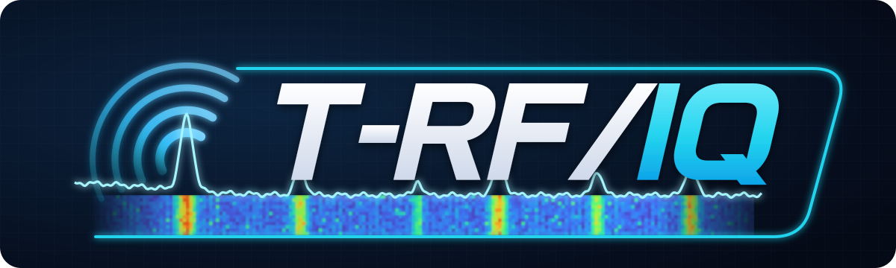
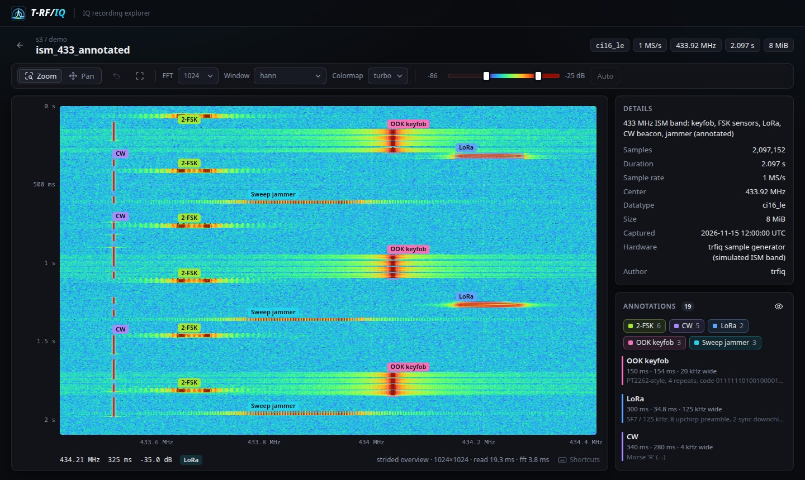
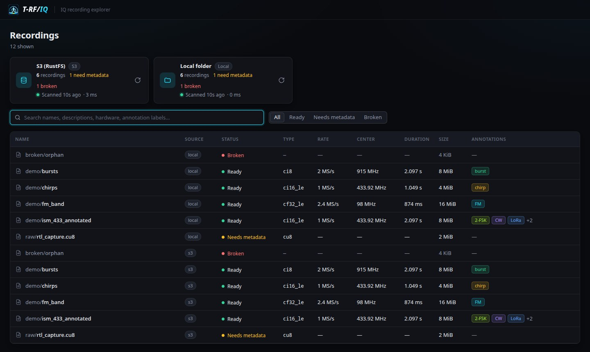
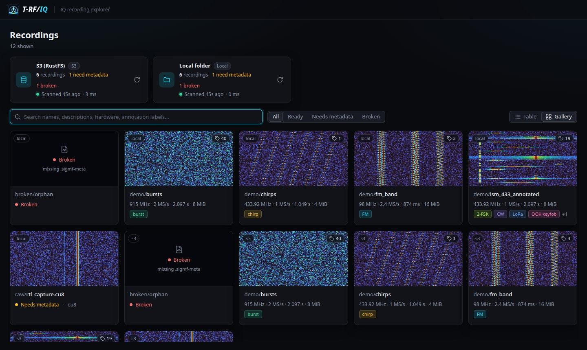
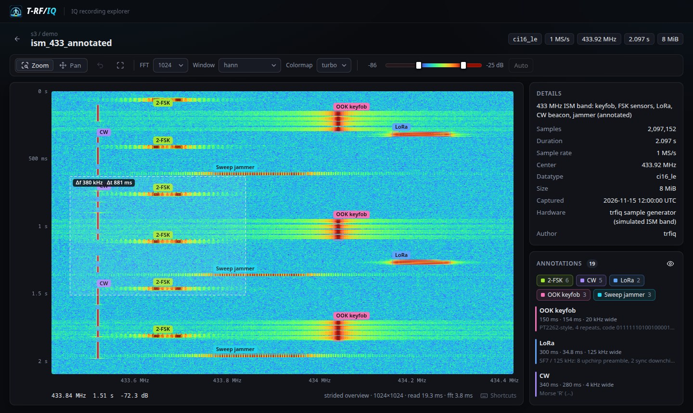
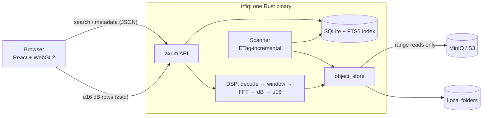

<p align="center">
  
</p>

<p align="center">
  <b>A fast, self-hosted explorer for IQ recordings. S3/MinIO first.</b><br>
  SigMF and raw captures · FFT on the server in Rust · WebGL2 spectrogram · instant search across buckets
</p>

<p align="center">
  <a href="https://github.com/marotoby/trfiq/actions/workflows/ci.yml"></a>
  
  
  
  
  
</p>

<p align="center">
  
</p>

---

**T-RF/IQ** (repo and binary: `trfiq`) indexes the IQ recordings in your S3 buckets and local
folders and lets you browse, search and inspect them in the browser. It's built as a faster, more
stable alternative to IQEngine. The hard work happens on the server, so the browser stays
responsive even on 100 GB files.

- **Instant browsing.** Recordings are indexed in SQLite and refreshed incrementally: only metadata
  whose ETag changed is re-read. Listing and searching 10k+ recordings is a local query.
- **Big files, small transfers.** The server reads only the byte ranges it needs, runs the FFTs in
  Rust and sends quantised dB. Raw samples never travel to the browser.
- **Smooth viewer.** A WebGL2 spectrogram applies colormap and levels in the shader: they change
  instantly, with no refetch. Pan and zoom run at display rate.
- **Safe by design.** T-RF/IQ never writes to your buckets; it only needs list and get permissions.

📖 **[Wiki](docs/wiki/Home.md)**: getting started, configuration, deployment, viewer guide, formats, API and troubleshooting.

## Contents

- [Features](#features)
- [SigMF support](#sigmf-support)
- [Quick start](#quick-start)
- [Connect your MinIO / S3](#connect-your-minio--s3)
- [Using the viewer](#using-the-viewer)
- [How it works](#how-it-works)
- [Performance](#performance)
- [HTTP API](#http-api)
- [Development](#development)
- [Roadmap](#roadmap)

## Features

| | |
|---|---|
| **Sources** | Any number of S3-compatible buckets (MinIO, AWS, RustFS, …) and local folders, side by side |
| **Formats** | SigMF pairs in every datatype (`cf64 cf32 ci32 ci16 ci8 cu32 cu16 cu8`, real variants, LE/BE); raw `.bin .cfile .iq .raw .dat .cu8 .cs8 .cs16 .cf32` with the datatype guessed from the extension. See [SigMF support](#sigmf-support) |
| **Browse** | Table view with a waterfall preview when you hover a recording, a gallery of waterfall thumbnails, or a folders view (source and directory tree with counts) |
| **Index & search** | Full-text search over names, descriptions, hardware and annotation labels; filter by status. The API also filters by datatype, frequency band and capture date (UI filters: [#6](https://github.com/marotoby/trfiq/issues/6)) |
| **Spectrogram** | FFT 256 to 16384, Hann / Blackman-Harris / rectangular windows, turbo / viridis / gray colormaps, max-hold downsampling so short bursts never vanish when zoomed out |
| **Spectrum & time plots** | For whatever time range is on screen: power spectrum (mean + max hold) and I/Q over time. Raw samples when zoomed in, a min/max envelope when zoomed out, so peaks never disappear |
| **Navigation** | Box zoom with live Δf/Δt, wheel zoom per axis, drag to pan, zoom history, keyboard control |
| **Annotations** | SigMF annotations drawn as labelled boxes on the spectrogram and as bands on the time plot; a side panel to filter by label and click to zoom |
| **Shareable** | Every view (file, FFT, colormap, levels, zoom) lives in the URL, so a link reproduces it exactly |
| **Operations** | One 44 MB distroless non-root image, `/healthz` and `/readyz`, JSON logs, per-source scan status in the UI |

<p align="center">
  
  
</p>

## SigMF support

T-RF/IQ reads [SigMF](https://sigmf.org) recordings: a `name.sigmf-meta` next to a
`name.sigmf-data`, at any depth in a bucket or folder. It never writes metadata.

**Datatypes:** all 24, complex and real. That is `f64 f32 i32 i16 i8 u32 u16 u8`, each with a
`c` (complex) or `r` (real) prefix, and `_le` or `_be` on the multi-byte ones. Samples are
normalised to ±1 full scale and power is shown in dBFS.

**Fields it uses:**

| Field | Used for |
|---|---|
| `global.core:datatype` | Decoding (required; without it the recording is **Broken**) |
| `global.core:sample_rate` | Time and frequency axes. Without it, axes are in samples and cycles/sample |
| `global.core:description`, `core:author`, `core:hw` | The Details panel and full-text search |
| `captures[0].core:frequency` | Centre frequency of the axis |
| `captures[0].core:datetime` | Capture date (shown, and filterable through the API) |
| `annotations[].core:sample_start`, `core:sample_count` | Annotation time extent (no `sample_start`: skipped; no `sample_count`: 1 sample) |
| `annotations[].core:freq_lower_edge`, `core:freq_upper_edge` | Annotation frequency extent in Hz (absent: the whole band) |
| `annotations[].core:label`, `core:comment` | Box label, colour, filter chip and search; comment in the side panel |

The whole metadata document is kept in the index and returned by
`GET /api/recordings/{id}`, so every other field, extensions included, is available to API
clients even though the UI doesn't interpret it yet.

**Not supported yet:**

| SigMF feature | What happens today |
|---|---|
| Several `captures` segments | Only the first segment's frequency and date are used; a retune mid-file isn't shown on the axis |
| `core:header_bytes` | Not skipped: the header bytes are decoded as samples |
| `core:num_channels` > 1 | Channels aren't de-interleaved |
| `.sigmf` archives (tar) | Not opened |
| `.sigmf-collection` | Ignored |
| Non-conforming datasets (`core:dataset`) and metadata-only recordings | Listed as **Broken** (`missing .sigmf-data`) |
| Extension namespaces (`antenna:`, `capture_details:`, …) | Stored and returned by the API; not shown in the UI |

Raw IQ files without metadata are listed too; see [Recording status](#recording-status).
Field-by-field details: [Recordings and formats](docs/wiki/Recordings-and-Formats.md) in the
wiki.

## Quick start

Run the demo stack: an S3 server, generated demo recordings and T-RF/IQ.

```sh
git clone git@github.com:marotoby/trfiq.git && cd trfiq
docker compose -f deploy/compose.yml up --build
```

Open **http://localhost:8080**. The S3 console is at http://localhost:9001 (`trfiq` / `trfiq-dev-secret`).

The demo includes FM stations, chirps, short bursts, a raw rtl_sdr capture, a deliberately broken
pair, and **`demo/ism_433_annotated`**: a simulated 433 MHz band with 19 annotations (OOK keyfob,
2-FSK sensors, LoRa, a Morse CW beacon and a sweep jammer).

> The demo S3 server is [RustFS](https://github.com/rustfs/rustfs), a MinIO-compatible server,
> because MinIO no longer publishes community images. T-RF/IQ talks plain S3, so your own MinIO
> works unchanged.
>
> **podman-compose** can't start a service that waits for a one-shot service to *finish*, so
> `trfiq` stays "Created". Use Docker Compose, or `podman start` the trfiq container once `seed`
> has exited.

## Connect your MinIO / S3

```sh
docker build -f deploy/Dockerfile -t trfiq .

docker run -d --name trfiq -p 8080:8080 \
  -e S3_ENDPOINT=http://minio.lan:9000 \
  -e S3_BUCKET=recordings \
  -e S3_ACCESS_KEY_ID=… -e S3_SECRET_ACCESS_KEY=… \
  -v trfiq-data:/var/lib/trfiq \
  trfiq
```

Read-only credentials are enough (`s3:ListBucket`, `s3:GetObject`). The volume holds only the index
and caches; delete it any time and it's rebuilt by rescanning.

For a reverse proxy subpath, build with `--build-arg TRFIQ_BASE_PATH=/trfiq/` and strip
`/trfiq` at the proxy. The browser router and built assets use that base path; API calls
still use the host's root `/api/`, which must also route to T-RF/IQ.

For several buckets, endpoints or local folders, mount your own config at `/etc/trfiq/config.yaml`:

```yaml
listen: 0.0.0.0:8080
data_dir: /var/lib/trfiq
scan_interval_secs: 300          # incremental rescan; the UI also has a Rescan button

sources:
  - id: lab                      # stable id used in URLs and the index
    name: Lab MinIO
    kind: s3
    endpoint: http://minio.lan:9000
    bucket: recordings
    prefix: captures/            # optional
    access_key_id: ${S3_ACCESS_KEY_ID}           # ${VAR} / ${VAR:-default} from the environment;
    secret_access_key: ${S3_SECRET_ACCESS_KEY}   # an unset ${VAR} stops startup, loudly
  - id: archive
    kind: local
    path: /mnt/recordings        # mount it read-only
```

### Recording status

| Status | Meaning |
|---|---|
| **Ready** | Valid SigMF pair; viewable |
| **Needs metadata** | Raw file; the datatype is guessed from the extension where a convention exists |
| **Broken** | Half of a SigMF pair is missing, or the metadata doesn't parse (the UI says which) |

## Using the viewer

<p align="center">
  
</p>

| Action | Mouse | Keyboard |
|---|---|---|
| Zoom into a region | Drag a box (Zoom mode) | |
| Pan | Drag (Pan mode), or right/middle-drag in any mode | Arrow keys |
| Zoom time / frequency | Wheel / Shift+wheel (Ctrl+wheel: both) | `+` `−` / `]` `[` |
| Previous view | Back button | Backspace |
| Show everything | Double-click, or the fit button | `0` |
| Zoom / pan mode | Toolbar toggle | `Z` / `H` |
| Annotations | Click a box, or an item in the side panel to zoom to it | `A` toggles the overlay |
| Spectrum / time plots | Toolbar toggles; drag inside a plot to zoom it, double-click to reset | `S` / `T` |
| Levels | Drag the two handles on the colorbar; **Auto** resets | |

Hovering shows frequency, time, power and the annotation under the cursor.

The **Spectrum** and **Time** panels under the spectrogram always cover the time range that's
visible, so zoom into a burst and they show just that burst. The spectrum also follows the
frequency zoom. Annotations are drawn on the time plot as labelled bands; click one to select
it. Each request reads at most ~2M samples. Over that, the panel shows a `sampled`
badge: FFT segments, or slices of the envelope, are spread evenly across the window.

## How it works



- **Storage:** every source is an [`object_store`](https://docs.rs/object_store) backend, so S3 and
  local folders share one code path. Requests are batched, coalesced and capped per source.
- **Spectrogram data:** power in dBFS, quantised to `u16` (`dB = -200 + q × 0.005`). Colour is
  applied on the GPU, so display changes are free
  ([ADR 2](docs/adr/0002-server-side-u16-db-tiles.md)).
- **Overview:** the first view of a file uses ~1k evenly spaced FFTs, so even 100 GB opens instantly
  ([ADR 3](docs/adr/0003-strided-overview-then-maxhold-pyramid.md)).
- **Cancellation:** when the browser abandons a request (you zoomed away), the server stops reading
  and computing.

Full design: [`docs/DESIGN.md`](docs/DESIGN.md) · decisions: [`docs/adr/`](docs/adr/).

## Performance

Measured on the demo stack (S3 on localhost):

| Operation | Budget | Measured |
|---|---|---|
| Recording list from the index | < 300 ms | a few ms |
| First overview of a file (1024 × 1024) | < 2 s | 16 to 32 ms end to end from S3 |
| Colormap / levels change | instant | no request, shader only |
| Incremental rescan, unchanged bucket | | a few ms (metadata is not re-read) |
| Spectrum / time plots of a 2M-sample window | | ~15 ms (read + compute) |
| Waterfall thumbnail (256 × 128) | | a few ms; only for cards on screen |

The 100 GB load test is on the roadmap.

## HTTP API

| Endpoint | |
|---|---|
| `GET /api/sources` | Sources with scan status and counts per status |
| `POST /api/sources/{id}/rescan` | Trigger an incremental rescan |
| `GET /api/recordings?q=&source=&status=&datatype=&fmin=&fmax=&from=&to=&limit=` | Search the index (`q`: prefix full-text; `fmin`/`fmax`: band overlap in Hz) |
| `GET /api/recordings/{id}` | One recording plus its full SigMF metadata |
| `GET /api/recordings/{id}/overview?fft=&rows=&window=` | `rows × fft` little-endian `u16` (fftshifted); headers carry the layout and a `Server-Timing` breakdown |
| `GET /api/recordings/{id}/psd?start=&count=&fft=&window=` | Power spectrum of a sample window: `fft` mean dBFS then `fft` max-hold dBFS, little-endian `f32`, fftshifted |
| `GET /api/recordings/{id}/time?start=&count=&points=` | I/Q of a sample window: raw `[i, q]` pairs up to 65,536 samples, otherwise `points × [iMin, iMax, qMin, qMax]` (`x-trfiq-mode`) |
| `GET /healthz` · `GET /readyz` | Liveness; readiness (every source scanned at least once) |

## Development

You need podman (or Docker) and [bun](https://bun.sh). No host Rust toolchain is needed:
`scripts/cargo.sh` runs cargo in a pinned Rust container.

```sh
deploy/dev-s3.sh                       # S3 on :9000 with demo data in bucket `recordings`
scripts/cargo.sh run --release -p trfiq-server -- --config deploy/config.dev.yaml   # API on :8080
cd web && bun install && bun run dev   # UI with hot reload on :5173 (proxies /api)
```

```sh
scripts/cargo.sh fmt --all --check
scripts/cargo.sh clippy --workspace --all-targets -- -D warnings
scripts/cargo.sh test --workspace      # unit, numpy golden, index/scanner, HTTP API
cd web && bun run typecheck && bun run test && bun run build   # types, unit tests, bundle
cd web && bunx playwright test         # e2e against a running server (TRFIQ_URL, default :8080)
```

| Path | |
|---|---|
| `crates/dsp` | Sample decoding, windows, FFT → quantised dB; golden tests against numpy/scipy |
| `crates/storage` | S3 / local sources over `object_store` (read-only) |
| `crates/index` | SQLite + FTS5 index and the incremental scanner |
| `crates/server` | HTTP API, background scans, embedded UI |
| `web/` | React + Vite UI, WebGL2 spectrogram, Playwright e2e |
| `deploy/` | Dockerfile, compose demo stack, example configs |
| `scripts/` | Demo data, golden fixtures and logo generators, containerised cargo |

### Commits and releases

Commits follow [Conventional Commits](https://www.conventionalcommits.org), checked with
[commitizen](https://commitizen-tools.github.io/commitizen/) (config in `.cz.toml`).
[`CHANGELOG.md`](CHANGELOG.md) is generated from them.

```sh
uvx --from commitizen cz commit        # guided commit message
uvx --from commitizen cz bump          # bump the version (Cargo.toml + web/package.json), update the changelog, tag
```

## Roadmap

- [x] S3 + local sources, incremental SQLite/FTS5 index, search and filter API
- [x] Server-side overview with cancellation; WebGL2 spectrogram with max-hold downsampling
- [x] Box zoom, zoom history, keyboard navigation, deep links
- [x] SigMF annotation overlay and panel; annotations on the time plot
- [x] Spectrum (mean + max hold) and time-domain I/Q of the visible window
- [x] Table, gallery and folders views with waterfall previews
- [x] Distroless image, compose demo stack, numpy golden tests, Playwright e2e, CI
- [x] Full-resolution tiles when zoomed past the overview, with the coarse view shown while loading ([#1](https://github.com/marotoby/trfiq/issues/1))
- [ ] Background max-hold pyramid and an LRU disk tile cache ([#2](https://github.com/marotoby/trfiq/issues/2))
- [ ] Constellation plot ([#3](https://github.com/marotoby/trfiq/issues/3)); band-limit the time plot to the visible frequency range ([#4](https://github.com/marotoby/trfiq/issues/4))
- [ ] Metadata entry for raw files (stored in the index), with JSON export/import ([#5](https://github.com/marotoby/trfiq/issues/5))
- [ ] Frequency and date filters in the UI (the API already supports them) ([#6](https://github.com/marotoby/trfiq/issues/6))
- [ ] Prometheus `/metrics` ([#7](https://github.com/marotoby/trfiq/issues/7))
- [ ] Byte-plane shuffle before compression ([#8](https://github.com/marotoby/trfiq/issues/8))
- [ ] 100 GB synthetic-file load test against the performance budgets ([#9](https://github.com/marotoby/trfiq/issues/9))

---

<p align="center"><br><sub>T-RF/IQ: see the spectrum, not the spinner.</sub></p>
