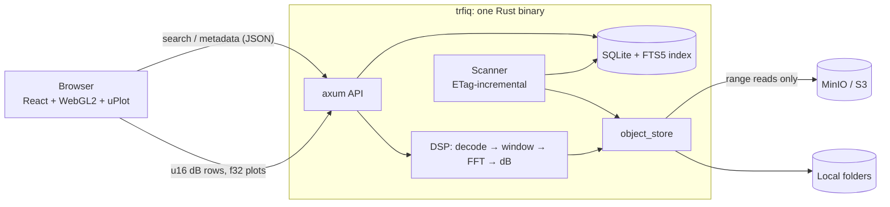

# Architecture

## Why it's fast

IQEngine's main problems were a slow spectrogram, big files freezing the browser and slow
listing. Each has a structural fix here:

| Problem | Cause | Fix |
|---|---|---|
| Slow listing | Listing the bucket and parsing metadata on every visit | A persistent SQLite + FTS5 index, refreshed incrementally by ETag |
| Big files freeze the browser | Raw samples downloaded to the browser | The server reads byte ranges and sends the result: quantised dB rows or a few thousand plot points. Raw samples never reach the browser |
| Slow spectrogram | FFT and colouring in JavaScript | FFTs in Rust on all cores; colouring in a WebGL2 shader, so colormap and level changes cost nothing |

## Components

| Crate / folder | Does |
|---|---|
| `crates/storage` | Sources (S3 or local) behind one `object_store` API: list, head, get, range reads. No write methods exist. A per-source semaphore caps concurrency |
| `crates/index` | The SQLite schema, FTS5 search and the incremental scanner, which groups objects into recordings, parses SigMF and assigns a status |
| `crates/dsp` | Decodes every SigMF datatype to complex f32; windows; FFT to dBFS; quantisation; PSD (mean and max hold); min/max envelopes |
| `crates/server` | The axum API, background scans and the embedded UI (rust-embed). `samples.rs` is the sample-window reader every sample endpoint goes through: window checks, read plans under the 2M-sample detail cap, range reads, cancellable compute and timing |
| `web/` | React 19, TanStack Router, Query, Table and Virtual; a WebGL2 spectrogram outside React's render loop; uPlot for the detail plots |

## Key decisions

Each decision has an ADR in [`docs/adr/`](../adr/):

1. **Rust backend over `object_store`** ([ADR 1](../adr/0001-rust-backend-with-object-store.md)):
   S3 and local folders share one code path, with predictable latency and a single small binary.
2. **Server-side `u16` dB tiles** ([ADR 2](../adr/0002-server-side-u16-db-tiles.md)): the
   server sends power, not pixels. `dB = −200 + q × 0.005` keeps 0.005 dB resolution in 2 bytes,
   and the browser colours it on the GPU.
3. **Strided overview, then a max-hold pyramid**
   ([ADR 3](../adr/0003-strided-overview-then-maxhold-pyramid.md)): the first view samples ~1k
   FFTs across the file, so it costs the same for 1 MB or 100 GB. A background max-hold pyramid
   (roadmap) will make every zoom level exact.
4. **SQLite index** ([ADR 4](../adr/0004-sqlite-index.md)): embedded, zero-ops, FTS5 for search.
   The index is derived data and can always be rebuilt.
5. **Read-only data buckets** ([ADR 5](../adr/0005-read-only-data-buckets.md)): nothing is ever
   written to sources. User-entered metadata will live in the index.
6. **Overview rows centred in equal slots**
   ([ADR 6](../adr/0006-overview-rows-centred-in-slots.md)): row `i` of `R` is one FFT from
   the middle of the `i`-th `N/R` samples, which is exactly where the viewer draws it.

Full design: [`docs/DESIGN.md`](../DESIGN.md).

## Request lifecycle: opening a recording

1. The browser asks for `/api/recordings/{id}` (from the index) and
   `/overview?fft=1024&rows=1024`.
2. The server splits the file into 1,024 equal slots, plans one FFT-sized read centred in each
   (`ReadPlan` in `crates/server/src/samples.rs`) and asks the source for those byte ranges in
   batches. `object_store` merges nearby ranges into fewer S3 requests.
3. The FFTs run in parallel on the rayon pool, checking a cancel flag between rows. If the
   browser abandons the request (you changed the FFT size), the flag is set and work stops.
4. The rows go back as `u16` with their layout in headers. The browser uploads them as one
   `R16UI` texture.
5. Pan, zoom, colormap and levels are now pure GPU work. The detail plots then ask for
   `/psd` and `/time` over the visible window.
