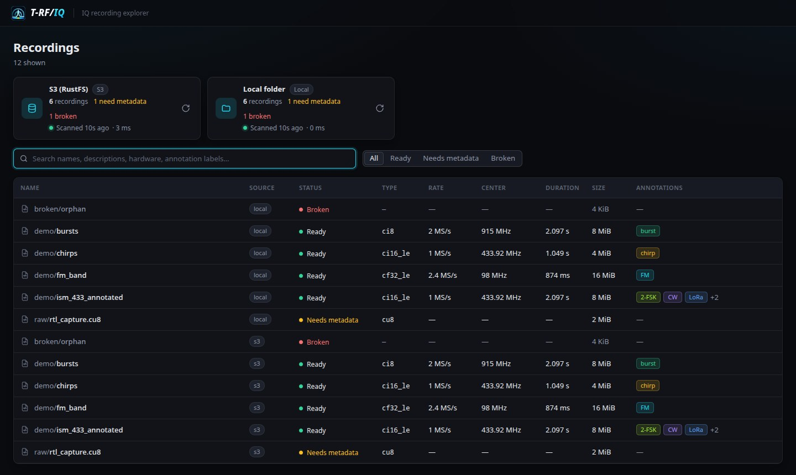
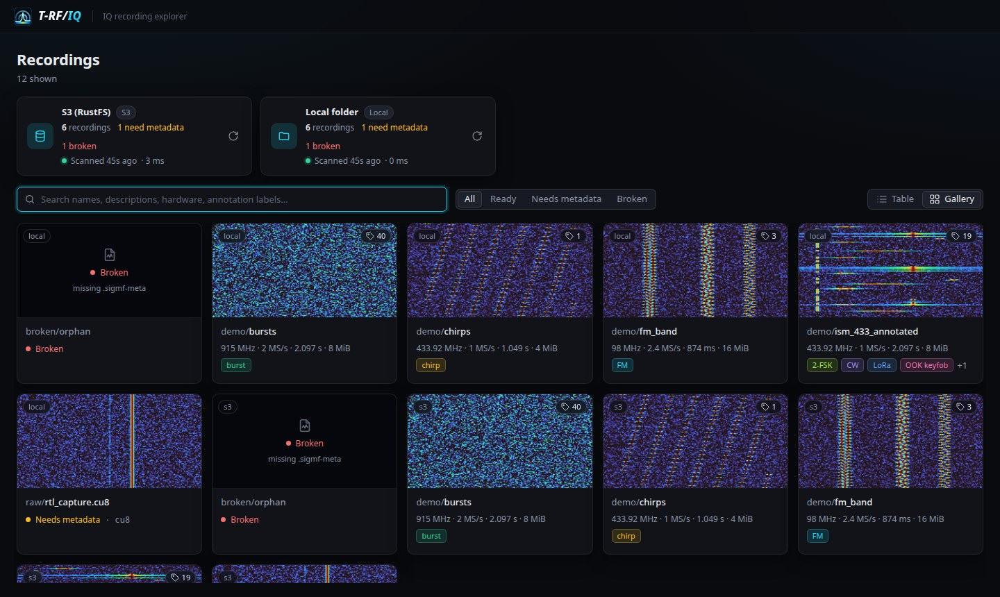

# Browsing recordings

The **Recordings** page lists everything in the index.

## Sources

One card per configured source shows its recording count, how many need metadata or are
broken, and when it was last scanned (with how long the scan took). The ↻ button rescans that
source now. While a scan runs the card shows *Scanning…*, and the list refreshes when it
finishes. If a scan fails, the card says so; hover it for the error.

## Search and filter

- **Search** matches words, and word prefixes, in paths, names, descriptions, author,
  hardware and annotation labels. `lora` finds every recording with a LoRa annotation.
- **All / Ready / Needs metadata / Broken** filters by [status](Recordings-and-Formats.md#status).

The API also filters by datatype, frequency band and capture date (see [HTTP API](HTTP-API.md));
those filters aren't in the UI yet.

Search text, filters and view mode are kept in the URL, so you can bookmark or share them.

## Table view

- Click a column header to sort; click again to reverse.
- **Rest the mouse on a row** for a moment to see a waterfall preview of the whole recording,
  with its duration and frequency span. Broken recordings have no preview.
- Click a row to open it in the [viewer](Using-the-Viewer.md).

The table only renders the rows on screen, so it stays smooth with tens of thousands of rows.

## Gallery view

A card per recording with a waterfall thumbnail, its source, annotation count, centre
frequency, sample rate, duration, size and labels. Broken recordings show why instead of a
picture. Click a card to open it.

Thumbnails load only when they scroll into view and are cached for the session. They are
coloured from the noise floor up so signals stand out.

> Thumbnails, like the viewer's first view, are built from evenly spaced slices of the file.
> Very short, sparse bursts can fall between slices and not show up. The max-hold pyramid on
> the roadmap fixes this.

## Folders view

A file-explorer view of your sources:

- **Left:** a tree with *All sources* at the top, then each source, then the folders inside it.
  Every entry shows how many recordings it holds, subfolders included. Click a name to open it;
  click the arrow to expand or collapse it.
- **Right:** a breadcrumb (click any part to go back up), cards for the subfolders, and a table
  of the recordings directly in the open folder. The table works like the Table view, hover
  preview included.

Search and the status filter apply here too, so the tree shows only folders that contain
matches. Searching `lora` shows where your LoRa recordings live. The open folder is in the URL
(`?view=folders&dir=lab/captures/2026`), so you can bookmark it and the browser's Back button
goes back up.

Folders come from the recordings' paths in the bucket (S3 has no real folders). A folder with
no recordings in it or below it doesn't appear.

## Remembered choices

Your last view (table, gallery or folders) is remembered in the browser. A `?view=…` in the URL
takes precedence.
