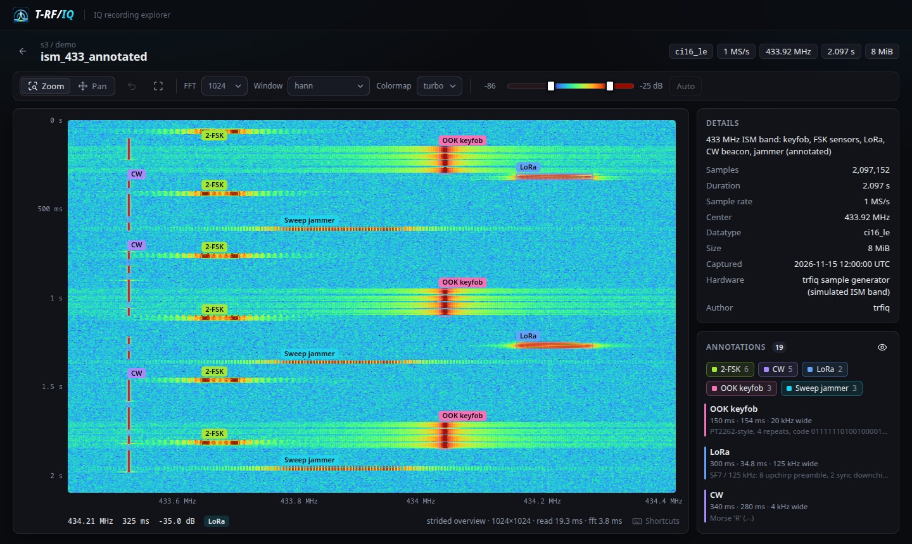

# T-RF/IQ wiki

**T-RF/IQ** (`trfiq`) is a self-hosted web app that indexes the IQ recordings in your
S3/MinIO buckets and local folders and lets you browse, search and inspect them in the
browser. The server reads byte ranges and runs the FFTs, so the browser never downloads
raw samples and stays responsive even on 100 GB files.

## Start here

| I want to… | Read |
|---|---|
| Try it in two minutes with demo data | [Getting started](Getting-Started.md) |
| Point it at my MinIO / S3 bucket | [Configuration](Configuration.md) |
| Run it for my team | [Deployment](Deployment.md) |
| Know which files show up, and why one is "Broken" | [Recordings and formats](Recordings-and-Formats.md) |
| Find my way around: table, gallery, folders | [Browsing recordings](Browsing-Recordings.md) |
| Learn the viewer, its plots and shortcuts | [Using the viewer](Using-the-Viewer.md) |
| Script against it | [HTTP API](HTTP-API.md) |
| Understand how it works inside | [Architecture](Architecture.md) |
| Fix something that isn't working | [Troubleshooting](Troubleshooting.md) |
| Build, test or change it | [Development](Development.md) |
| Cut a release | [Releasing](Releasing.md) |

## At a glance

- **Read-only.** T-RF/IQ never writes to your buckets; list and get permissions are enough.
- **Fast listing.** Recordings are indexed in SQLite and refreshed incrementally by ETag, so
  listing and searching 10k+ recordings is a local query.
- **Big files, small transfers.** The first view of a file reads ~1k evenly spaced FFTs.
  Detail plots read at most ~2M samples per request.
- **One container.** A 44 MB distroless, non-root image with the UI embedded in the binary.
- **Formats.** SigMF pairs in every datatype, plus common raw IQ files.

## Current version

`0.2.1`: see [`CHANGELOG.md`](../../CHANGELOG.md). The
[roadmap](../../README.md#roadmap) lists what is still missing, notably the max-hold
pyramid and metadata entry for raw files.
