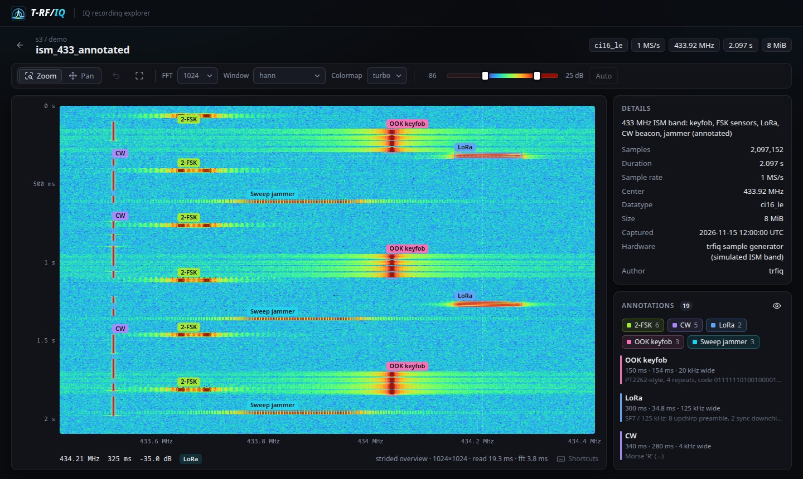

# Using the viewer

The viewer has four parts:

- a **toolbar** for mouse mode, history, FFT, window, colormap, levels and panels;
- the **spectrogram**, with frequency across and time downwards;
- the **Spectrum** and **Time** panels under it;
- a side panel with **Details** and **Annotations**.

## Spectrogram

When a recording opens, the server computes about 1,024 FFTs spread evenly over the whole
file. This "strided overview" is why even a 100 GB file opens in well under a second. The
status bar shows its size and how long the read and the FFTs took.

When zoomed out, each pixel shows the **maximum** of the data it covers (max-hold), so short
bursts don't vanish between pixels.

> Beta limitation: zooming in magnifies the overview rather than fetching more detail, so a
> deep zoom looks blocky. Full-resolution tiles are on the roadmap. The **Time** panel already
> shows every sample once zoomed in far enough.

### Mouse and keyboard

| Action | Mouse | Keyboard |
|---|---|---|
| Zoom into a region | Drag a box (Zoom mode). A thin box zooms one axis only | |
| Pan | Drag (Pan mode), or right/middle-drag in any mode | Arrow keys |
| Zoom time | Wheel | `+` `−` |
| Zoom frequency | Shift + wheel | `]` `[` |
| Zoom both | Ctrl + wheel | |
| Previous view | ↶ button | Backspace |
| Show everything | Double-click, or the fit button | `0` or Home |
| Zoom / pan mode | Toolbar toggle | `Z` / `H` |
| Annotation overlay on/off | 👁 in the Annotations panel | `A` |
| Spectrum / time panel on/off | Toolbar toggles | `S` / `T` |
| Cancel a drag | | Esc |

Keyboard shortcuts work when the spectrogram has focus (click it once). While dragging a box,
a pill shows its Δf and Δt. Hovering shows frequency, time, power and the annotation under the
cursor in the status bar.

### Display settings

| Setting | |
|---|---|
| **FFT** | 256 to 16384 bins. Larger means finer frequency resolution but coarser time resolution. Changing it refetches |
| **Window** | Hann (default), Blackman-Harris (lower sidelobes, for weak signals next to strong ones) or rectangular |
| **Colormap** | turbo, viridis or gray. Instant: no refetch |
| **Levels** | Drag the two handles on the colour bar to set the floor and ceiling in dB. **Auto** resets to a range picked from the data. Instant: no refetch |

## Spectrum and Time panels

Both panels always analyse the **time range currently visible** in the spectrogram. Zoom into a
burst and they show just that burst. They follow the view about a quarter of a second after it
stops moving.

**Spectrum** is the power spectrum of that range: the **mean** (cyan) and **max hold** (amber)
of FFTs across it, using the toolbar's FFT size and window. Its frequency axis follows the
spectrogram's frequency zoom. The header shows how many FFTs were combined.

**Time** shows I (cyan) and Q (pink) against time:

| Window | Shown as | Badge |
|---|---|---|
| Up to 65,536 samples | Every sample | none |
| Up to ~2M samples | The min and max of each of ~2,000 buckets, read from every sample, so no peak is lost | `ENVELOPE` |
| Over ~2M samples | The same envelope, built from evenly spaced slices | `SAMPLED ENVELOPE` |

The Spectrum panel shows `SAMPLED` when its window is over ~2M samples and the FFTs are spread
evenly across it. The Time panel shows the full band: it isn't filtered to the frequency
zoom yet.

Inside either panel: drag to zoom that plot alone, double-click to reset it, and hover for
values (shown in the legend).

## Annotations

SigMF annotations appear:

- on the spectrogram as labelled boxes;
- on the Time panel as shaded bands;
- in the **Annotations** panel as a list with label chips.

| To | Do |
|---|---|
| Zoom to an annotation | Click it in the panel |
| Select one | Click its box on the spectrogram, or its band on the Time panel |
| Hide a label everywhere | Click its chip in the panel |
| Hide them all | 👁 or `A` |

## Sharing a view

Everything that defines the view is in the URL: the recording, FFT size, window, colormap,
levels and the zoom region. Copy the address bar to share exactly what you see.

| Parameter | |
|---|---|
| `fft`, `window`, `cmap` | Display settings |
| `lo`, `hi` | Levels in dB (absent = Auto) |
| `v=x0,x1,y0,y1` | Visible region as fractions of the full recording: x is frequency, y is time from the start |

The mouse mode and which panels are open are personal preferences, remembered in your browser
rather than in the URL.
